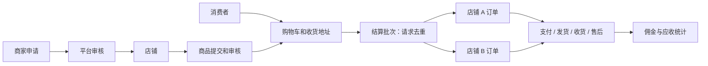

# 多商家商城功能规划与实现边界

## 1. 产品定位

目标是自营招商运营的多商家实物商品平台，包括消费者、入驻商家、平台管理员三种身份。保留现有 Go + Gin + gRPC + MySQL + Redis 后端和 React + Umi + Ant Design 前端。

当前提交实现交易核心版本，**不是全部商业功能已完成的生产系统**。下表逐项区分已有实现与后续工作，支付、资金结算不以模拟结果冒充真实处理。

约定：人民币；后端金额统一用整数分；单账号一家店；一个商品一个可售规格；订单按店铺拆分；暂不收取运费；平台佣金默认 5%，管理员可配置；每店每订单独立付款、履约和售后。没有擅自假定平台具备支付分账资质。

## 2. 全量功能地图

| 领域 | 完整功能范围 | 当前交付 |
| --- | --- | --- |
| 账号与身份 | 注册、登录、验证码、退出、令牌刷新、找回密码、短信/邮箱验证、账号注销、多因素认证 | 邮箱注册、图形验证码、密码登录、现有令牌流程；平台用户管理权限限制、禁用校验；其余待实现 |
| 消费者首页 | 频道、店铺、商品推荐、轮播、专题、搜索、筛选、排序、浏览足迹 | 已审核商品列表、名称搜索、分类查询接口；独立店铺主页、内容运营待实现 |
| 商家入驻 | 主体资质、联系人、审核/驳回、重新提交、冻结/解冻、合同、保证金 | 单店申请、营业执照号、联系人、平台审核、冻结、佣金配置；证照文件/实名核验/合同/保证金待接入 |
| 商家组织 | 店铺资料、营业状态、员工、部门、岗位、操作授权 | 店铺所有者权限与店铺数据隔离；员工级 RBAC 待实现 |
| 商品中心 | 分类、品牌、SPU/SKU、规格、图片、详情、价格、上下架、审核、批量导入 | 平台分类新增/列表、单规格商品新增/编辑、图片 URL、审核和下架；多规格/品牌/文件上传/批量导入待实现 |
| 库存中心 | 可售/预占库存、库存流水、多仓、采购、入库、盘点、预警 | 下单预占、取消/超时回补、库存增减与审计；多仓/采购/预警待实现 |
| 购物车 | 数量修改、删除、选择商品、失效商品、按店展示、收藏 | 持久化购物车、数量覆盖更新、删除、勾选下单、商品名称/现价/小计；收藏和店铺分组视图待实现 |
| 地址簿 | 新增、编辑、删除、默认地址、地区联动 | 新增、删除、列表、选择结算地址；编辑/默认地址/地区联动待实现 |
| 结算 | 价格试算、优惠、运费、库存检查、按店拆单、重复提交保护、订单备注 | 服务端计价、库存/店铺校验、按店拆单、地址快照、请求幂等；优惠、运费、订单备注待实现 |
| 订单中心 | 状态流转、订单详情、取消、超时关闭、交易快照、售后 | 已实现基础流程；消费者/商家/平台查询隔离、订单商品和金额快照 |
| 支付中心 | 微信/支付宝、渠道签名、回调验签、主动查单、对账、合单支付、关单、退款 | 仅显式启用的沙箱订单付款/退款；真实渠道均未接入，生产模式禁止沙箱 |
| 物流履约 | 运费模板、快递发货、拆包裹、电子面单、轨迹、签收、同城、自提 | 手工物流公司/运单号、确认收货；物流查询/面单/多包裹待接入 |
| 售后中心 | 退款、退货退款、换货、举证、商家审批、平台仲裁、退货入库 | 整单售后申请、审核、驳回恢复原状态、平台沙箱退款；部分退款/退货寄回/换货/时限政策待实现 |
| 评价与互动 | 评价、追评、图片、商家回复、举报、客服、消息通知 | 待实现 |
| 营销中心 | 店铺券/平台券、满减、限时折扣、秒杀、拼团、积分、会员价、活动互斥 | 待实现；上线营销前先扩展订单优惠快照和资金分摊模型 |
| 财务结算 | 佣金、账期、冻结金额、结算单、分账、提现、流水、退款冲正、对账、发票 | 下单佣金快照、有效成交与已完成订单应收统计；没有真实分账、提现和打款 |
| 平台运营 | 商家审核、商品审核、违规治理、分类、内容配置、广告、客户运营 | 商家/商品审核、分类、用户管理、审计；内容/广告/CRM 待实现 |
| 数据分析 | 平台/商家/消费者订单数与交易金额、趋势、漏斗、复购、商品排行、导出 | 基于实际订单的范围统计；趋势、BI、导出待实现 |
| 安全和运维 | 认证、租户权限、限流、审计、备份、监控、告警、压测、恢复演练 | 复用现有认证与遥测；新增服务端权限、事务和审核/库存/订单审计；完整限流/恢复演练/压测待完成 |
| 客户端 | 管理工作台、商家工作台、消费者 Web、移动端、小程序 | 一个 Web 项目承载三种身份的基础页面；独立移动商城/小程序待实现 |

## 3. 领域模型和模块边界

- 用户域：既有 `mall_user` 库，gRPC 用户服务。用户名和邮箱唯一，注册不能申请管理员身份。
- 交易域：`mall` 库。`shops`、`categories`、`products`、`addresses`、`cart_items`、`checkouts`、`orders`、`order_items`、`audits`。
- 平台身份：现阶段复用既有 `admin` 保留用户名约定；其他账号均不自动获得管理权限。完整角色/权限管理是下一步独立工作。
- 店铺身份：通过持久化 `owner_id` 判断，客户端传入 `shopId` 仅用于选择资源，不提供授权。
- 订单身份：买家读取自己的订单；商家读取自己店铺订单；平台读取全平台。管理员不能冒充买家付款或确认收货。
- 商品编辑会重新进入待审核状态，库存变更走独立接口，避免商品编辑覆盖交易预占结果。

## 4. 已实现的交易规则

1. 购物车、地址归属从登录身份校验，不接受客户端指定买家。每次结算最多 100 行，每行数量 1–999。
2. 服务端读取商品价格；以整数分计算总价和佣金，佣金按子订单向下取整。订单保留商品名称、单价、数量及地址快照。
3. 结算在一个数据库事务内完成：幂等批次 → 校验并锁定购物车 → 按固定顺序锁店铺和商品 → 扣可售库存 → 创建各店订单 → 清购物车 → 写审计。任意一店失败则全部回滚。
4. 同一买家同一 `requestKey` 重试返回原订单；换了商品或地址却复用该键会拒绝。数据库唯一索引防止重复请求创建重复批次。
5. 待付款订单过期 30 分钟后由 API 服务每分钟检查关闭，每轮最多 100 单。支付操作同时检查有效期，不能在过期后补付沙箱订单。
6. 取消和超时操作锁定订单后改变状态，只返还一次库存。未发货订单退款返还库存；已发货或已完成订单退款不自动入库，避免尚未收到退货就增加可售库存。
7. 冻结店铺商品不再进入公开列表，不能继续下单或发货。已有订单仍保留，消费者可申请售后，由平台介入。
8. 真实支付未配置时返回明确失败。沙箱支付是一次订单状态演示，不产生支付凭证、不调用资金通道。`--server.mode=release` 不允许同时开启沙箱。
9. 商家审核佣金调整只影响后续订单，不重算已有订单快照。
10. 结算统计不等于打款台账。售后中的订单不计入当前有效成交金额，退款通过后不计入应收。

## 5. 实施顺序与验收条件

### A：交易核心（本次代码）

消费者注册与登录 → 商家申请和平台审核 → 分类与商品发布审核 → 地址与购物车 → 按店下单 → 沙箱支付 → 发货与收货 → 基础售后 → 统计审计。

必须验收：跨商家越权被拒；重复提交不重复扣库存；任意店库存不足整批回滚；取消/过期/退款不重复回补；普通用户不能访问用户管理和平台审核。

### B：上线前交易能力

真实支付适配器、渠道订单/退款记录、回调验签与幂等、异步通知补偿、主动查单和日对账；真实物流；完整注册限流和账号找回；文件上传、证照审核和商品多规格；正式数据迁移和 MySQL 并发压测。

必须验收：伪造回调不能改变订单；重复回调和乱序回调不重复记账；支付成功但本地写入失败能恢复；退款总额不超实付；一份库存并发最多成交一次。

### C：多商家财务与运营

不可变账本、佣金配置规则、结算周期、资金冻结/释放、售后冲正、结算单审批、合规支付分账渠道、发票和对账；平台/商家完整 RBAC 和员工账号；营销券及分摊。

必须验收：平台佣金 + 商家应收 + 各方补贴/退款可逐分核对；财务动作完整审计；未到期、售后冻结金额不能提现。

### D：增长与体验

评价、客服、消息通知、推荐、收藏、浏览记录、会员积分、活动、移动端、小程序、内容运营、数据分析。

### E：规模与稳定性

订单超时任务迁至独立作业；事务 outbox/消息队列；慢查询与索引治理；搜索引擎；多仓；备份恢复演练；容量测试、告警和故障预案。

## 6. 后续需由运营确认的业务政策

代码默认值可用于开发验证，正式发布前还需确定：商家准入材料、佣金规则、结算账期、运费承担、退换货时限与责任、平台介入规则、发票开具主体、支付渠道及分账账户。资料和渠道密钥应由项目方提供，不应在代码中虚构。
